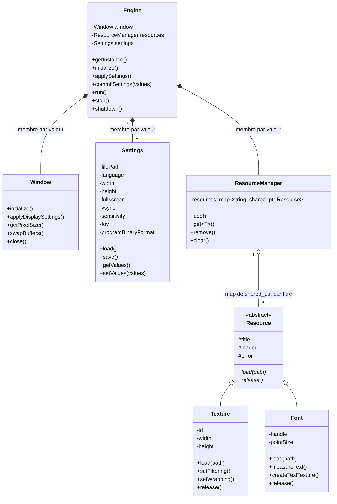
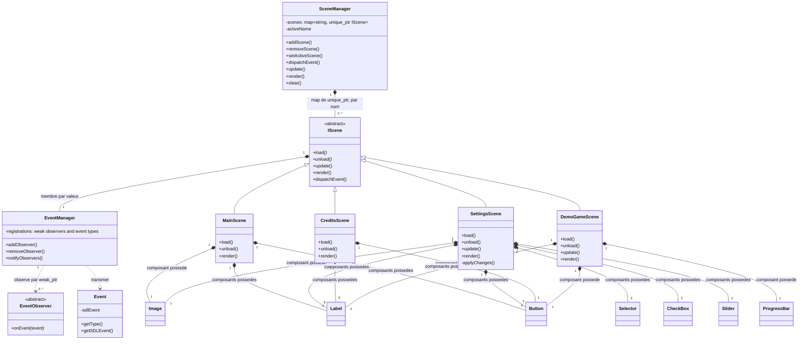
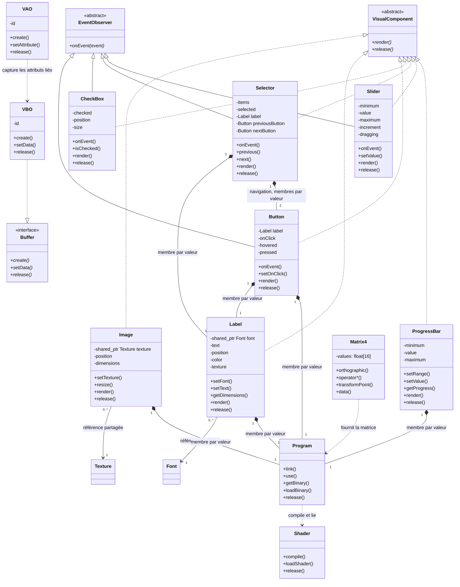

# Diagramme de classes du TP1

Ces diagrammes Mermaid décrivent la version actuelle du code dans `include/moteur/` et `src/moteur/`. **C’est le diagramme de classes courant à remettre.** Le fichier [`Classes-initiale.uxf`](Classes-initiale.uxf) est le modèle antérieur du début du projet; il ne décrit pas l’architecture actuelle. Les vues sont séparées pour rester lisibles dans GitHub.

## Moteur, paramètres et ressources

## Scènes et événements

## Rendu et contrôles visuels

## Relations et patrons

- `Engine` est un Singleton. Il possède la fenêtre, les paramètres et le gestionnaire de ressources.
- `SceneManager` possède de zéro à plusieurs scènes par `unique_ptr`; au plus une scène est active. Il charge la destination avant de décharger la scène courante. Si le chargement échoue, il décharge la destination partielle et conserve l’ancienne scène active.
- Chaque `IScene` possède un `EventManager` par valeur. Ce gestionnaire observe de zéro à plusieurs composants via des `weak_ptr`; la scène garde la propriété de ses composants. `unload()` retire leurs inscriptions, y compris après un chargement partiel.
- `ResourceManager` détient des `shared_ptr<Resource>` pour ses entrées titrées. Les scènes et contrôles gardent aussi des références partagées aux ressources qu’ils utilisent. Aucun composant de scène ne doit appeler `Texture::release()` ou `Font::release()`; il libère ses propres composants, et la dernière référence détruite libère la ressource.
- `MainScene` possède une image, deux étiquettes et quatre boutons. `SettingsScene` possède une image, huit étiquettes et huit contrôles interactifs. `CreditsScene` possède six étiquettes et un bouton. `DemoGameScene` possède deux étiquettes, une barre de progression et un bouton. Les scènes libèrent leurs composants au déchargement.
- Les sept contrôles réalisent `VisualComponent`. `Button`, `CheckBox`, `Selector` et `Slider` réalisent aussi `EventObserver`. `Selector` possède une étiquette et deux boutons de navigation par valeur; seul le sélecteur est observé par les événements de la scène.
- Les programmes, VAO et VBO appartiennent aux contrôles par valeur. Le VAO capture la configuration du tampon lié, mais ne possède pas le VBO. `VBO` réalise le contrat `Buffer`.
- `SettingsScene` recueille les choix de l’interface et appelle `Engine::commitSettings`. `Engine` applique l’affichage à `Window`; `Settings` valide et sauvegarde les valeurs.

