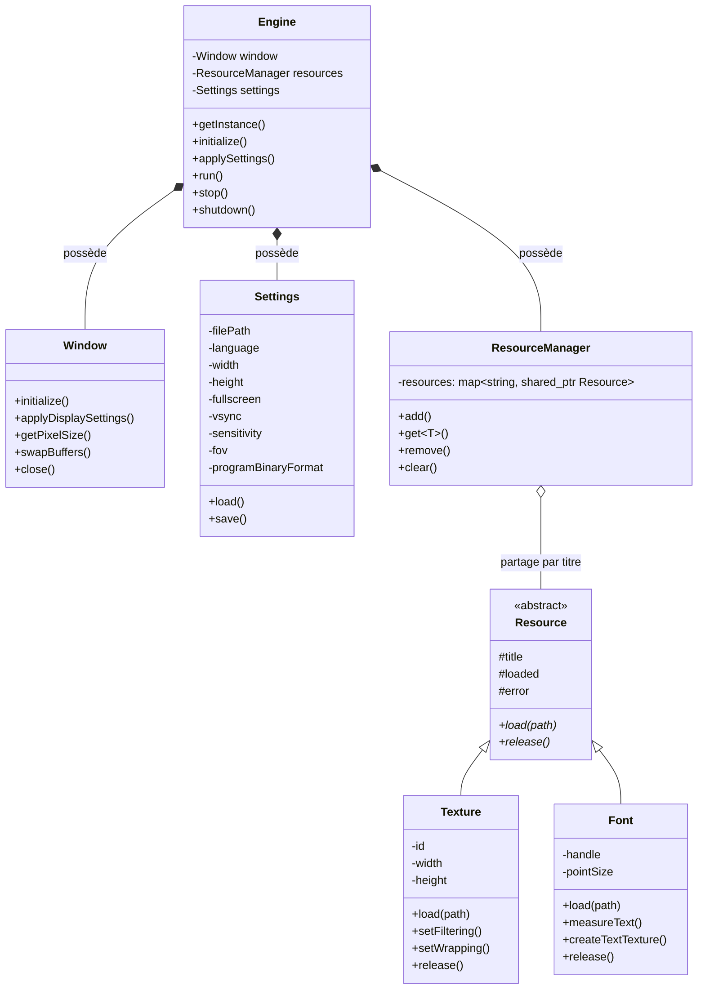
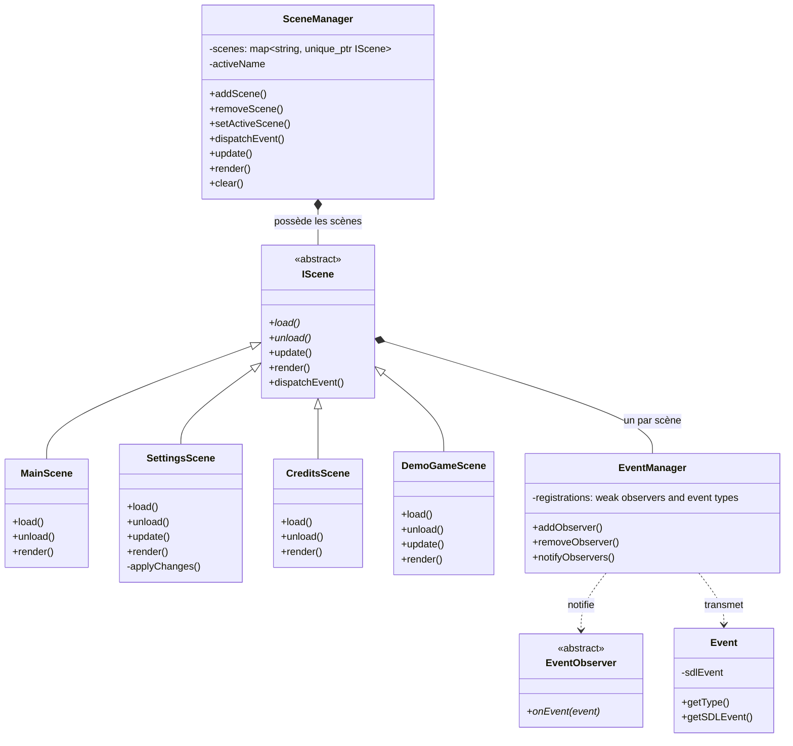
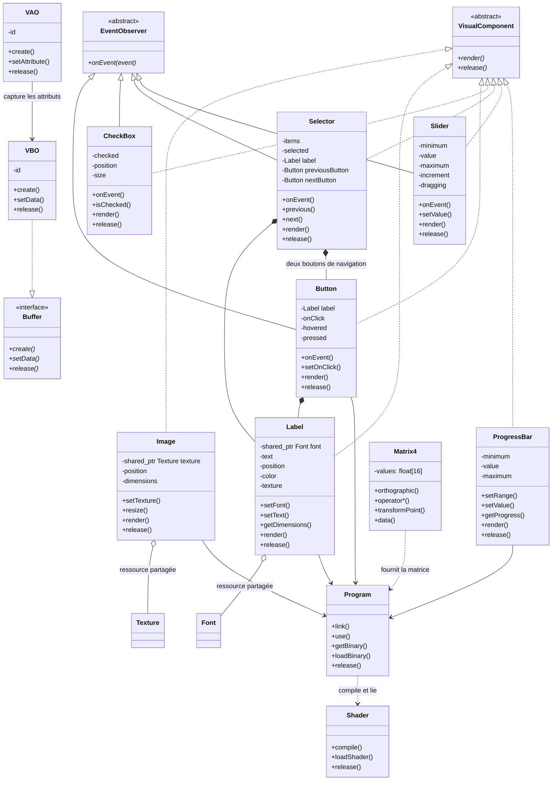

# Diagramme de classes du TP1

Ces diagrammes Mermaid décrivent les classes et les relations de la version actuelle du code dans `include/moteur/` et `src/moteur/`. Les vues sont séparées pour rester lisibles dans GitHub.

## Moteur, paramètres et ressources

## Scènes et événements

## Rendu et contrôles visuels

## Relations et patrons

- `Engine` est un Singleton. Il possède la fenêtre, les paramètres et le gestionnaire de ressources.
- `SceneManager` possède les scènes par `unique_ptr`. Chaque scène possède son propre `EventManager`.
- `EventManager` applique le patron Observateur : il notifie les observateurs inscrits pour un type d’événement.
- `ResourceManager` conserve les ressources par titre avec des références partagées.
- Les scènes sont chargées par `SceneManager` au moment de leur activation, puis déchargées à leur désactivation.
- Les sept contrôles implémentent `VisualComponent`. `Button`, `CheckBox`, `Selector` et `Slider` implémentent aussi `EventObserver`.
- `Selector` compose une étiquette et deux boutons de navigation. Seul le sélecteur est inscrit au gestionnaire d’événements de sa scène.
- `VBO` réalise le contrat `Buffer`. `VAO` mémorise les attributs associés au tampon de sommets.

## Fichiers de diagrammes

- [Diagramme vectoriel SVG](Classes.svg) — rendu historique; il ne montre pas encore `VisualComponent` et `Buffer`.
- [Aperçu PNG](Classes.png) — rendu historique correspondant au SVG.
- [Diagramme UMLet initial](Classes-initiale.uxf) — document conservé comme historique de conception.

Les diagrammes Mermaid ci-dessus représentent les abstractions présentes dans le code actuel. Les rendus PNG et SVG peuvent être conservés comme archives ou supprimés plus tard si vous décidez de ne maintenir que le diagramme Mermaid.
